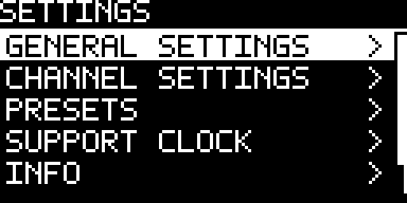
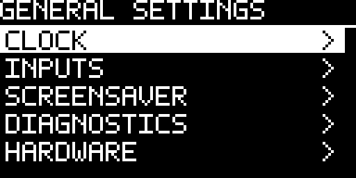
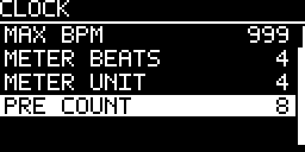
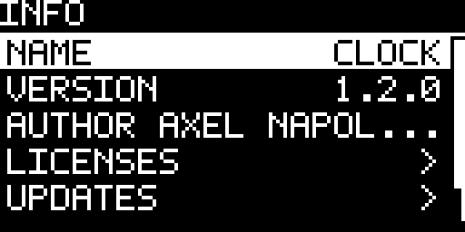
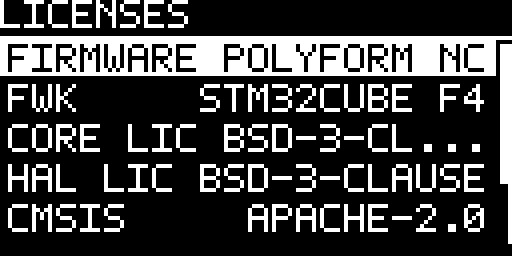

<!-- Author: Axel Napolitano | License: PolyForm-Noncommercial-1.0.0 -->

# 15 Settings map

Hold **TAP TEMPO** and press the encoder from Performance to open the root Settings tree. The root is organized by scope rather than by implementation detail.

| Root item | Contains / does |
| --- | --- |
| **GENERAL SETTINGS** | Global CLOCK, INPUTS, SCREENSAVER, DIAGNOSTICS and HARDWARE pages. |
| **CHANNEL SETTINGS** | The currently selected Independent channel or the active One Clock / Divider Bank topology. |
| **PRESETS** | CURRENT recovery, Load/Save Preset, and factory Templates. |
| **SUPPORT CLOCK** | Ko-fi destination for supporting ongoing CLOCK development. |
| **INFO** | Product/version information, licenses, update QR and guarded Factory Reset. |
| **PHASE RESET** | Immediate non-destructive global musical phase reset. |

### GENERAL SETTINGS

GENERAL SETTINGS contains values shared by the whole device, not one output channel. `CLOCK` here means the **master clock configuration**, not the Independent channel mode named CLOCK.

| Page | Scope |
| --- | --- |
| **CLOCK** | Master BPM, user BPM limits, master meter, global Pre-Count. |
| **INPUTS** | INPUT 1/2 role assignment plus shared external clock/reset configuration. |
| **SCREENSAVER** | Screensaver and STOP-only display-protection timers. |
| **DIAGNOSTICS** | Live conditioned input states and eight gate-driver output states. |
| **HARDWARE** | Encoder direction and complete 0° / 180° framebuffer orientation. |

### CLOCK — tempo, meter and Pre-Count

| Setting | Meaning |
| --- | --- |
| **TEMPO** | Internal/fallback quarter-note tempo reference in BPM. |
| **MIN BPM / MAX BPM** | User/Tap-Tempo editing bounds: 1…999 with `MIN ≤ MAX`; factory range 20…999. These limits do not clamp a valid measured external clock. |
| **METER BEATS** | 1…16 beats per bar. Used by the bar/beat counter and Pre-Count beat cells. |
| **METER UNIT** | 2 / 4 / 8 / 16. Selects the note value represented by one master beat. |
| **PRE COUNT** | OFF or 1…64 silent beats before a fresh STOP→PLAY. All gates stay LOW and pattern phase remains zero until the count completes. |

The BPM number remains the quarter-note reference. `METER UNIT` chooses the note value represented by one master beat, and `METER BEATS` chooses how many of those beats form one bar. At 120 BPM this means, for example:

| Meter | Master beat | Bar duration |
| --- | --- | --- |
| `4/4` | 500 ms quarter-note beat | 2.0 s |
| `3/4` | 500 ms quarter-note beat | 1.5 s |
| `6/8` | 250 ms eighth-note beat | 1.5 s |
| `2/2` | 1000 ms half-note beat | 2.0 s |

The same meter definition drives the bar/beat counter and Pre-Count. With external SYNC, PPQN remains pulses per **quarter note**; CLOCK converts accepted pulses into the configured master-beat unit.

### CHANNEL SETTINGS

Independent mode separates pattern generation from shared timing/output behavior. The most important controls are `DIV/MULT`, `POLY N`, `POLY D`, Swing, Groove, Probability, Gate length, Phase, Reset and Mute. Gate length is an absolute time value rather than a duty cycle; an otherwise-too-long pulse is shortened before the next rising event so it cannot consume the following onset.

One Clock exposes shared **TIMING** (rate, Swing, Groove, Humanize) and **OUTPUT** (Gate, Phase) pages. Divider Bank exposes divider family and one shared Gate length.

### SUPPORT CLOCK

`SUPPORT CLOCK` is an informational page with the current project-support destination. It does not alter firmware behavior or licensing.

- **KO-FI** — `ko-fi.com/southsignallab`

The publication manual also carries the Ko-fi QR code. The canonical repository links are maintained in [`../SUPPORT.md`](../SUPPORT.md).

### INFO and read-only overflow

`SETTINGS → INFO` groups identity, maintenance information and the deliberately buried factory-reset action:

- **NAME** — CLOCK product identity
- **VERSION** — currently running firmware version
- **AUTHOR** — project attribution; deliberately not treated as primary UI content
- **LICENSES** — firmware/framework/core/HAL/CMSIS license identifiers
- **UPDATES** — full-screen QR code for the firmware update address `https://southsignallab.com/clock/firmware`, which leads to the firmware releases

Long read-only values use a separate overflow rule from editable Settings values. If a value does not fit its row, CLOCK shortens only that informational value with `...`; pressing the row opens the complete value. Editable values keep their normal edit/confirm behavior. The license page is the canonical example: `CORE LIC` may display a truncated `BSD-3-Cl...` row while preserving the complete `BSD-3-Clause` identifier in the full-value view.

<table>
<tr>
<td align="center"> INFO</td>
<td align="center"> License identifiers and overflow</td>
<td align="center"> Updates</td>
</tr>
</table>

`PHASE RESET` is non-destructive: it applies the global musical reset immediately without stopping to erase or replace any saved configuration.

**FACTORY RESET**, by contrast, is the final INFO entry so it is not exposed as a routine performance control. Selecting it opens a separate confirmation screen with **NO** selected by default. Confirming **YES** stops transport, clears CURRENT, all eight named presets, all Custom Grooves, both Sequencer pattern and step-expression banks, legacy score data and all Top-100 leaderboards, then restores the documented factory configuration. It also lifts an **UPDATE FIRMWARE** lock.
