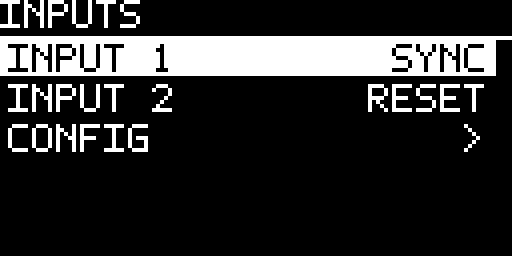
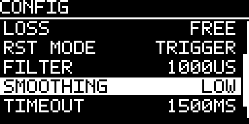
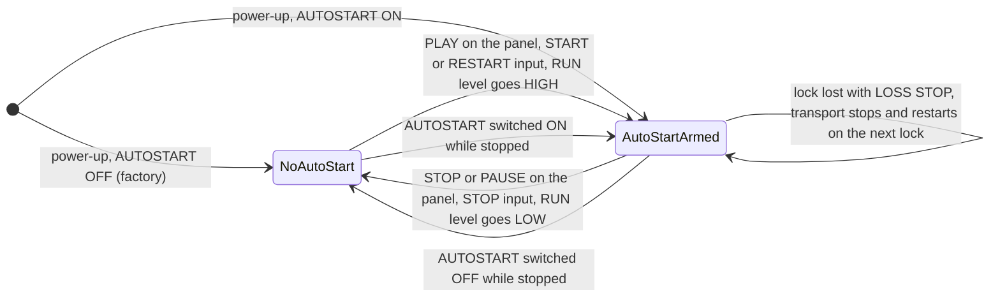
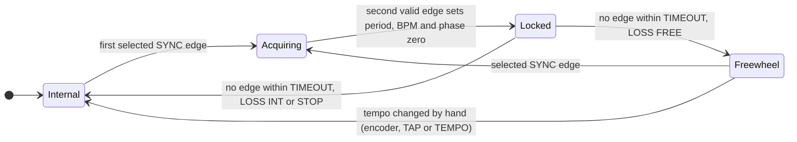

<!-- Author: Axel Napolitano | License: PolyForm-Noncommercial-1.0.0 -->

# 16 Configurable external inputs

Open `SETTINGS → GENERAL SETTINGS → INPUTS` to assign the two conditioned comparator inputs. The board still has the physical/net identities **SYNC/PA8** and **RST/PA9**; firmware presents them as **INPUT 1** and **INPUT 2** so either electrical path can own any supported digital-input role. Factory assignment is `INPUT 1 = SYNC`, `INPUT 2 = RESET`.

Three controls answer three different questions and should not be conflated:

| Control | Question it answers |
| --- | --- |
| **INPUT role** | What does this jack mean right now — SYNC, RESET, RUN, START, STOP, RESTART, TAP or OFF? |
| **SOURCE** | Who owns musical time — CLOCK itself (`INT`), the assigned SYNC input (`EXT`), or automatic handover (`AUTO`)? |
| **LOSS** | After an external clock had lock, what happens if that clock disappears — `STOP`, `FREE`, or `INT`? |

A jack assigned to **SYNC** does not by itself force external timing ownership. The role makes that jack available as the clock input; `SOURCE` decides whether the timing engine follows it.

### Input roles

| Role | Behavior |
| --- | --- |
| `OFF` | Ignore the conditioned input. `OFF` may be assigned to both inputs. |
| `SYNC` | Use selected edges for external period measurement, lock and phase alignment. |
| `RESET` | Apply global phase reset; `RST MODE` selects `TRIGGER` or `GATE` semantics. |
| `RUN` | After arming, conditioned `HIGH = PLAY`, `LOW = STOP`. Assigning/restoring RUN first baselines the present level and waits for a later physical change. A front-panel START/PAUSE or STOP wins until the RUN level changes the next time. |
| `START` | A positive edge requests PLAY. |
| `STOP` | A positive edge requests STOP. |
| `RESTART` | A positive edge performs deterministic STOP→PLAY from phase zero. |
| `TAP` | A positive edge is passed to the normal Tap-Tempo estimator with its captured input timestamp. |

`FILL` is reserved and is not selectable yet. Active non-`OFF` roles are exclusive across the two inputs. Changing a role drains queued edges from the old meaning before the new role becomes active, so one electrical transition cannot later be reinterpreted as a different command.

Short triggers count. A trigger that is already over when the input interrupt runs still fires START, STOP, RESTART, TAP and RESET (`TRIGGER`) exactly once; RUN and RESET (`GATE`) follow only the input level. Several triggers within one interrupt latency count as one; that can only happen while the processor is blocked, for example while a preset is written to Flash with the clock stopped. A START trigger during such a write arrives late, by up to the rest of the write, but is not lost.

<table>
<tr>
<td align="center"> Input-role assignments</td>
<td align="center"> Shared clock/reset configuration</td>
</tr>
</table>

### SOURCE — who owns musical time?

| SOURCE | Behavior |
| --- | --- |
| `INT` | CLOCK is the master. Configured internal BPM and meter drive musical time. |
| `EXT` | CLOCK follows a valid assigned SYNC input. The first accepted selected edge starts acquisition; the second establishes the first measurable period, BPM and lock. |
| `AUTO` | CLOCK runs internally until a valid external period is acquired, then hands timing ownership to external SYNC. Loss is handled by `LOSS`. |

`AUTO` acquisition is deliberately staged:

1. Without a valid external period, CLOCK runs at the internal/fallback BPM.
2. The first accepted selected SYNC edge starts acquisition but cannot establish lock because there is no period yet.
3. The second valid selected edge establishes period and external BPM, acquires lock and re-anchors external phase to zero. A lock starts transport only while external auto-transport is armed: after power-up only with `AUTOSTART = ON`; during a session after a front-panel START, and again after a sync-loss stop.
4. If external edges later disappear for the effective timeout, lock is lost and `LOSS` decides what happens next.

An explicit user STOP or PAUSE has priority; incoming clock cannot silently undo a manual transport decision.

### LOSS — after external lock disappears

| LOSS | Behavior |
| --- | --- |
| `STOP` | Stop transport. A later valid reacquisition may restart only if the stop was caused by sync loss; a manual STOP remains authoritative. |
| `FREE` | Continue at the last measured external tempo and keep that BPM as the effective/visible tempo after lock loss. |
| `INT` | Continue using the configured internal/fallback BPM. |

#### State diagrams: automatic start and tempo ownership

Whether an external clock may start transport is a separate state from transport itself. An incoming clock never undoes a front-panel STOP or PAUSE:

Without auto-start a lock never starts transport and a lock loss never stops it. With an assigned `RUN` input, a front-panel PLAY, PAUSE or STOP stays in effect until the RUN level changes the next time.

Tempo ownership with `SOURCE = AUTO`:

While `Locked`, the encoder and TAP on the Performance screen do not change the tempo and the display shows **EXTERNAL CLOCK**. With `SOURCE = EXT` the same lock states apply, but the encoder and TAP never change the tempo, and with `LOSS = FREE` the last measured tempo stays until the next lock.

### PPQN, EDGE, FILTER, SMOOTHING, TIMEOUT and AUTOSTART

| Setting | Meaning |
| --- | --- |
| **PPQN** | `1 / 2 / 4 / 24` pulses per quarter note. It must match the source because period-to-BPM conversion uses it. |
| **EDGE** | Rising or falling. Only the selected transition is a timing pulse; pulse width is not the clock period. |
| **FILTER** | `0…5000 µs` minimum inter-edge rejection floor in 250 µs steps. Implausibly short selected-edge intervals are rejected as glitches and do not become the next period reference. |
| **SMOOTHING** | `OFF = 100%` newest period; `LOW = 75% new / 25% previous`; `MEDIUM = 50/50`; `FULL = 25% new / 75% previous`. Factory default is `LOW`. |
| **TIMEOUT** | `200…5000 ms` configured lock-loss floor. The effective timeout is never shorter than roughly two expected pulse periods, so a valid slow clock does not time out between pulses. |
| **AUTOSTART** | `OFF / ON`, factory `OFF`. `OFF`: CLOCK never starts on its own after power-up, not even when an external clock is already running. `ON`: a SYNC lock may start transport, including the first lock after power-up. Switching it while stopped applies to the next lock. |

`FILTER` and `SMOOTHING` solve different problems. FILTER rejects implausibly short edge spacing **before** it can become a new period reference. SMOOTHING decides how quickly **valid** period changes alter the measured tempo. A large FILTER can reject legitimate very-fast clock edges; heavy SMOOTHING deliberately follows real tempo moves more slowly.

### RESET — `TRIGGER` versus `GATE`

| RST MODE | Behavior |
| --- | --- |
| `TRIGGER` | One accepted active/high edge requests one global phase reset. Holding the input HIGH does not repeatedly reset and RESET does not itself PLAY, PAUSE or STOP transport. |
| `GATE` | The conditioned input level becomes a held reset state. HIGH resets phase and holds musical progression; LOW releases the hold and re-anchors runtime at the transition. |

Global reset still respects each Independent channel's local `RESET` policy: `GLOBAL` channels re-anchor; `FREE` channels preserve their local cycle relationship according to the channel reset contract. Transport roles (`RUN / START / STOP / RESTART`) remain separate from the RESET role.

Both physical comparator paths are captured by GPIO EXTI with TIM5 microsecond timestamps and consumed by the deterministic scheduler. Host tests cover this digital role/state-machine contract; actual LM393 thresholds, propagation, jack-level timing and output jitter remain HIL evidence.
