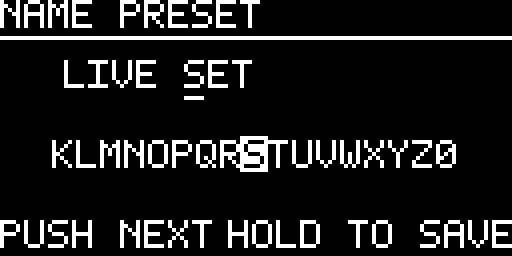
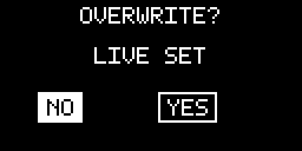

<!-- Author: Axel Napolitano | License: PolyForm-Noncommercial-1.0.0 -->

# 17 Presets, autosave and templates

`SETTINGS → PRESETS` contains three different concepts:

- **CURRENT — AUTO SAVE** is the durable working state;
- **LOAD PRESET / SAVE PRESET** use eight named user slots;
- **TEMPLATES** are factory starting configurations rather than user slots.

Preset names can contain up to 16 characters. Saving over an occupied slot requires explicit confirmation, with **NO** selected by default.

<table>
<tr>
<td align="center"> Preset name entry</td>
<td align="center"> Occupied-slot confirmation</td>
</tr>
</table>

Factory templates currently include `ALL MASTER`, `CLOCK TREE`, `DIVIDERS`, `POLYRHYTHM`, `EUCLID KIT`, and `HYBRID`. Loading a template changes CURRENT; it does not silently create or overwrite a named user preset.

### When settings reach Flash

CLOCK never writes Flash while transport is PLAY, because the STM32F401 stalls while a Flash sector is erased. Everything else is saved automatically once playback is STOPPED or PAUSED:

- ordinary edits (tempo, channel settings, Sequencer patterns and step expression) are saved **3 seconds after the last change**; while you keep editing, they are saved at the latest **30 seconds after the first unsaved change**;
- explicit saves (named presets, Custom Grooves) are written at the next opportunity;
- all pending changes share one Flash write.

If a RUN or START signal arrives during the short Flash write, playback starts right after the write instead of during it.

**SAVE ERROR** on the Performance screen means a Flash write failed. Your changes stay in memory and CLOCK retries automatically after 1, 2, 4, 8, 16, 32 and then every 60 seconds. If the message keeps returning, the Flash sector may be worn; changes made since the last successful write are lost when power is removed.

**SAVE LOCKED** means the Flash holds settings written by a newer firmware in a format this firmware does not know, typically after a downgrade. CLOCK still runs with the newest settings it can read but writes nothing, so the newer data stays intact for a later upgrade. Either install the newer firmware again or confirm **FACTORY RESET** (`INFO`), which replaces the stored data with factory settings and lifts the lock.
